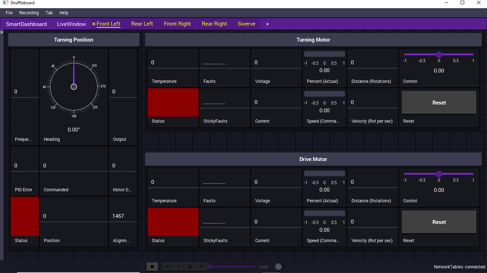
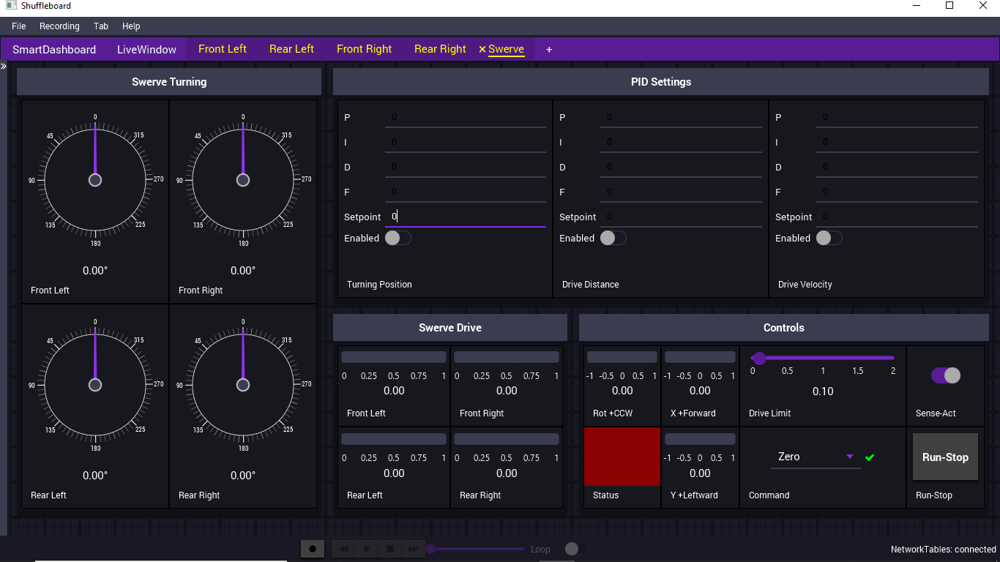

# Willa (updated for the 2026 season)
C++ robot code for Willa, Team 7443's 2024 robot, updated to build with the 2026 FRC software (WPILib 2026 and the 2026 vendor libraries).  Swerve drive: SPARK MAX/NEO turning plus SPARK FLEX/Vortex drive and an SRX MAG ENCODER per swerve module (i.e. SDS Swerve Module), with an arm (shoulder), intake, trigger, shooter and climbers; with Test Mode code.

Based on [Jagwires7443/Willa](https://github.com/Jagwires7443/Willa).

## 2026 software versions

| Library | 2024 | 2026 |
| --- | --- | --- |
| WPILib / GradleRIO | 2024.3.2 | 2026.2.1 (Gradle 8.11) |
| REVLib | 2024.2.4 | 2026.0.5 |
| navX | NavX 2024.1.0 (Kauai Labs) | Studica 2026.0.0 |
| PathPlannerLib | 2024.2.8 | 2026.1.2 |
| CTRE Phoenix 5 / 6 | 5.33.1 / 24.2.0 | removed (not used by this robot) |

Use the **2026 WPILib VS Code** to build and deploy.  Use "WPILib: Manage Vendor Libraries" → "Check for updates (online)" to pick up any newer vendor library releases.

## What changed for 2026

* **REVLib (SPARK MAX / FLEX).**  REV replaced the old one-parameter-at-a-time API (`CANSparkMax`, `SetP()`, `SetSmartCurrentLimit()`, `SetPeriodicFramePeriod()`, `RestoreFactoryDefaults()`, `BurnFlash()`, ...) with config objects applied via `Configure()`.  `infrastructure/SparkMax.cpp` was rewritten for this.  The `SmartMotorBase`/`SmartMotor` interface and the string-keyed `ConfigMap` settings (`"kStatus1"`, `"kSmartCurrentStallLimit"`, `"kP_0"`, ...) are unchanged, so the subsystems and swerve modules work the same way.  The mapping of each key to its REVLib 2026 setting is documented in `infrastructure/SparkMax.h`.  SmartMotion became MAXMotion.
* **navX.**  The navX library is now distributed by Studica: `studica::AHRS` (`<studica/AHRS.h>`), constructed with `NavXComType::kMXP_SPI`.
* **WPILib command-based controllers.**  `CommandXboxController`/`CommandGenericHID` no longer derive from `GenericHID`, so the `JoystickButton`/`POVButton` bindings now use `m_xbox.Start()`, `m_xbox.Back()`, `m_xbox.POVUp()`, `m_xbox.POVDown()`, and the button board's lights/axis counts use `m_buttonBoard.GetHID()`.
* **WPILib deprecations.**  `SwerveModuleState::Optimize()` (now an instance method), `CommandPtr::Schedule()` (now `CommandScheduler::GetInstance().Schedule()`), and the SysId `Config` constructor were updated.
* **PathPlanner.**  The 2024 `AutoBuilder::configureHolonomic()` (which was commented out) no longer exists.  The drive subsystem now calls the 2026 `AutoBuilder::configure()`, using the robot configuration from the PathPlanner GUI (`src/main/deploy/pathplanner/settings.json`).  If that file is missing, a message is printed and everything else works normally.  The existing timed autos (button board button 9 selects Left/Right) are unchanged.
* **Test Mode config burning.**  `RobotContainer::TestExit()` is called on entry to every mode; it now only does its work (including saving motor controller config to flash) if Test Mode actually ran.  Before, it tried to burn flash at the start of every Autonomous and Teleop.  REVLib 2026 refuses to do that while enabled.

## Before running on the robot

1. Update all SPARK MAX/FLEX firmware with the REV Hardware Client (REVLib 2026 expects current firmware).
2. Update the navX firmware if Studica's tools say it is out of date.
3. Run Test Mode once, then disable, so the motor controller configs are saved to flash.
4. Check that field-oriented drive and the swerve module/arm directions are still correct, before driving at speed.
5. To use PathPlanner autos, open the project in the 2026 PathPlanner GUI, set up the robot config, and deploy (this creates `src/main/deploy/pathplanner/`).  The PathPlanner PID constants (`pidf::kPath*` in `Constants.h`) are starting values and need to be tuned.

## Features

See [SwerveSensorInterfaceBoard](https://github.com/Jagwires7443/SwerveSensorInterfaceBoard) for details on electrical connections.

Here are some of the features implemented in this code:

* Handling PWM input from SRX MAG ENCODER to derive absolute position;
* Handling SPARK MAX/FLEX motor controllers;
* Profiled PID control of turning position;
* Using turning position to override commanded drive, when modules are not facing in commanded direction;
* Distance and velocity Profiled PID control of drive motors;
* Test Mode includes interactive adjustment of PID settings;
* Error handling for motor controllers, up to being able to test code on a roboRIO with no motor controllers;
* Test Mode uses Shuffleboard to create a tab for each swerve module, and a tab for the overall swerve drive;
* Step-by-step bring up procedure for swerve modules and drive system is documented in block comments (in `src/main/include/infrastructure/SwerveModule.h`);
* Provides several Test Mode routines to automatically have robot drive various fixed test patterns;
* Logic to manage and save configuration of motor controller settings;
* Primitives useful for autonomous driving;
* Integrated with WPILib.

Please see (and/or use) `shuffleboard.json` for suggested Shuffleboard settings.

